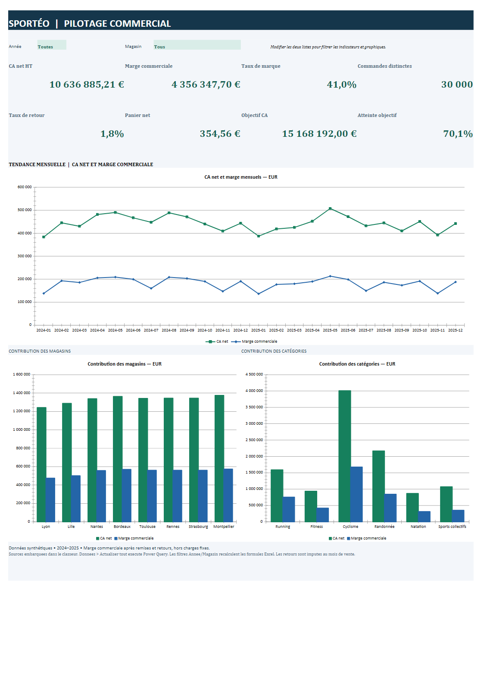

# Sportéo — Excel, Power Query et pilotage commercial

J’analyse les ventes, la marge et les objectifs de huit magasins fictifs sur 2024–2025. Mon objectif est de rendre les indicateurs compréhensibles, de contrôler leur calcul et de proposer un tableau de bord utilisable dans Excel.

## Ouvrir le projet

Ouvrir [Sporteo_Analyse.xlsx](excel/Sporteo_Analyse.xlsx), puis la feuille **Dashboard**. Les listes **Année** et **Magasin** filtrent les indicateurs et les trois graphiques natifs Excel. Les données chargées et les valeurs initiales sont déjà présentes dans le classeur.

## Mon approche

- Conserver la première occurrence de chaque identifiant de ligne et isoler les doublons.
- Rejeter les dates impossibles, quantités invalides, références inconnues et remises incohérentes.
- Calculer les ventes après remises et retours avec un arrondi au centime explicite.
- Distinguer marge commerciale, chiffre d’affaires et bénéfice net.
- Comparer les objectifs au grain mois-magasin pour éviter leur multiplication.

## Organisation du classeur

| Feuille | Rôle |
|---|---|
| Dashboard | Indicateurs, filtres Année/Magasin et trois graphiques modifiables |
| Lire_moi | Définitions, parcours et limites |
| Sources_* | Quatre tables sources embarquées |
| Ventes | Lignes nettoyées, enrichies et montants calculés |
| Commandes | Une ligne par commande pour le comptage distinct |
| Objectifs | Objectifs et réalisations au grain mois-magasin |
| Doublons / Rejets / Qualite | Piste d’audit et réconciliation des lignes |
| Calculs_Dashboard | Formules Excel alimentant les cartes et graphiques |

## Power Query

Les transformations sont intégrées au classeur et fournies dans [power-query](power-query/LIRE-MOI.md). Dans Excel Desktop, ouvrir **Données > Requêtes et connexions**, puis modifier une requête pour examiner ses étapes. **Actualiser tout** recharge les tables depuis les sources embarquées. Après actualisation, attendre la fin du traitement et vérifier le bilan Qualite.

## Repères sur le jeu synthétique

- 60 240 lignes brutes ; 240 doublons et 120 rejets isolés.
- 59 880 lignes analysées ; 30 000 commandes distinctes.
- CA net : **10 636 885,21 €**.
- Marge commerciale : **4 356 347,70 €** ; taux de marque : **40,96 %**.

## Rapports

- [PowerPoint modifiable](presentation/soutenance.pptx).
- [Rapport PDF](presentation/soutenance.pdf).
- [Synthèse](analysis/SYNTHESE.md).

Le [notebook](notebooks/analyse.ipynb) est conservé comme annexe de vérification indépendante des données. Il n’est pas nécessaire pour consulter le classeur.

## Validation et limites

Les 59 880 lignes et les cinq montants de vente ont été rapprochés au centime des CSV de référence. La syntaxe des douze requêtes M et de leur section complète est contrôlée avec l’analyseur Microsoft. Les caches de résultats, relations du classeur, graphiques et formules sont vérifiés. L’ouverture, le recalcul et l’actualisation Power Query dans Excel Desktop restent à valider sur cette application, absente de l’environnement de préparation.

Données synthétiques : aucune mission client réelle. La marge commerciale exclut charges fixes et fiscalité. Les retours sont imputés au mois de vente et supposés remis en stock. Les écarts observés ne démontrent pas une causalité.

## Aperçu du tableau de bord

[Consulter le tableau de bord en PDF](reports/tableau_de_bord.pdf). Les filtres sont interactifs dans le classeur Excel ; cet aperçu représente le périmètre global.

Les huit indicateurs ont aussi été vérifiés après recalcul forcé sous LibreOffice sur deux copies sans valeurs en cache : 2024/Lyon et 2025/Montpellier. Ce contrôle ne remplace pas la validation de l'actualisation Power Query dans Excel Desktop.
